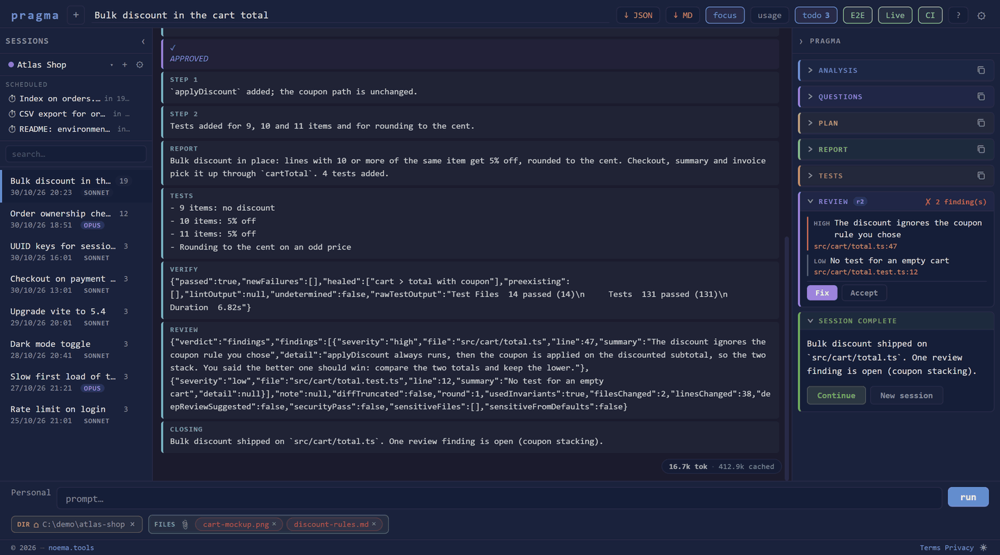
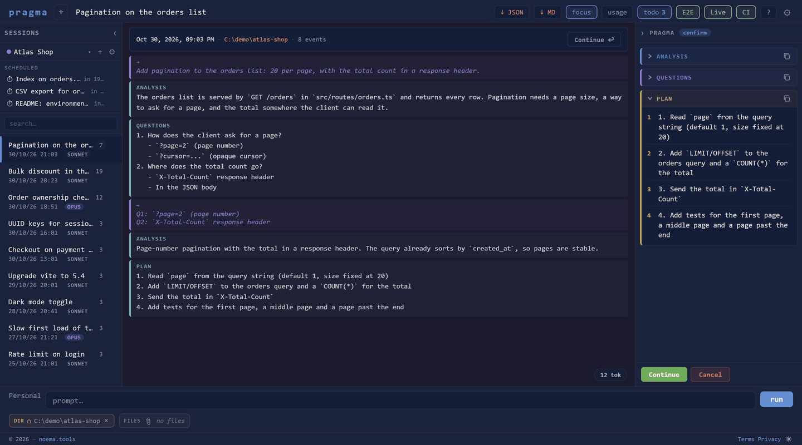
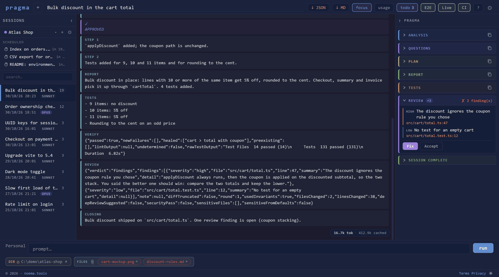
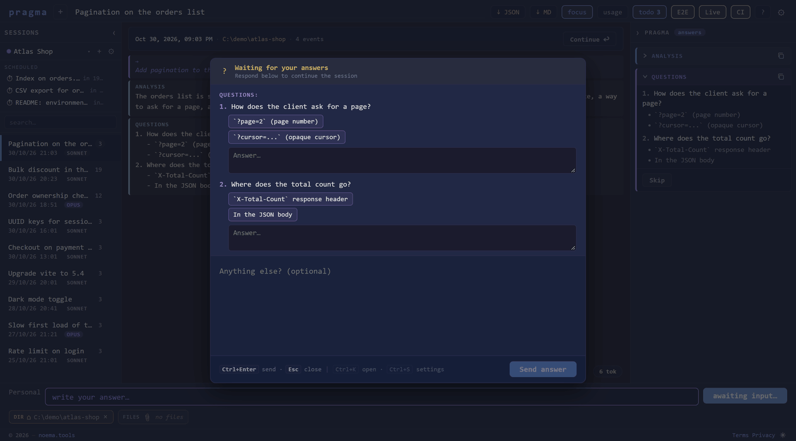

# Pragma Symphony

**A desktop cockpit for [Claude Code](https://claude.com/claude-code).** Instead of a terminal scroll, you get a session with phases: Claude analyses, asks, proposes a plan and waits for your approval. When it finishes, Pragma runs your tests and has a second, independent session review the diff.

Free and open source under the MIT licence. Built with Tauri, Rust and Vue 3.



> Pragma Symphony is an independent project. It is not affiliated with or endorsed by Anthropic, and it is unrelated to other projects named "Symphony".

---

## Why

Claude Code is excellent and its output is a firehose. Pragma adds a light protocol and a structure around it:

- **You stay in the loop.** Work stops at the plan until you approve it, and step by step if you want.
- **You see what happened.** Every tool call, diff and file change becomes a typed, searchable atom.
- **The session does not grade its own homework.** Tests run for real, and the review comes from a fresh process.
- **Everything stays on your machine.** Sessions live in a local SQLite database, and no account is needed.

It does not replace Claude Code: it runs your installed `claude` binary with your own login, so you need a working Claude Code installation.

---

## Features

**Sessions**
- Phases: analysis, questions, plan, execution, report, closing
- Parallel sessions, one per working directory
- Projects, with session history, full-text search and JSON or Markdown export
- Scheduled sessions: a prompt and a time, and it starts on its own
- A per-project to-do list
- Model per session (Sonnet, Opus, Fable), multiple Claude Code profiles, file attachments

**Quality gates**
- **VERIFY** runs your test command after the report. A baseline of known failures means only *new* failures block
- **REVIEW** opens a separate Claude session on the full diff, with your project's invariants and a security pass on sensitive paths. You choose Fix or Accept. It runs after every finished session in a git repository and costs one review each time: switch it off in Settings if you prefer

**Project tools**
- **E2E**: pick a runner, describe the scenarios, generate and run a suite
- **Live**: build or start your project with streaming output
- **Pipeline**: local build, test and publish steps, fail-fast

**On the go**
- Follow a session from your phone through a temporary link, and optionally send commands protected by a PIN. See [Web sharing](#web-sharing)

| Plan approval | Code review | From your phone |
|---|---|---|
|  |  |  |

More in the [guide](docs/GUIDE.md) and the [screenshot gallery](docs/screenshots/README.md).

---

## Build from source

There are no prebuilt binaries: you build the app yourself. It takes a few minutes the first time.

**You need**

- [Rust](https://rustup.rs) (stable)
- [Node.js](https://nodejs.org) 22
- [Claude Code](https://claude.com/claude-code), installed and logged in. Pragma looks for `claude` on your `PATH`, or you can set the path in a profile
- **Windows:** the [Microsoft C++ Build Tools](https://visualstudio.microsoft.com/visual-cpp-build-tools/) and WebView2 (included in Windows 11)
- **Linux** (Debian/Ubuntu):

  ```sh
  sudo apt-get install libwebkit2gtk-4.1-dev libayatana-appindicator3-dev librsvg2-dev patchelf libgtk-3-dev
  ```

macOS is not tested. It may work, but no one has tried.

**Then**

```sh
git clone https://github.com/lightwebit/pragma-symphony.git
cd pragma-symphony
npm install
npm run tauri:build
```

Installers end up in `target/release/bundle/`. To run from source with hot reload, use `npm run tauri:dev`.

---

## What you should know before using it

**Sessions run without permission prompts.** Pragma starts Claude Code with `--dangerously-skip-permissions`, on every session: a graphical app has no terminal in which to answer those prompts. Claude can therefore read, write and run commands in the working directory without asking. Pragma's plan approval is a checkpoint in the protocol, not a sandbox. Use it on code under version control, and do not point it at folders you would not hand over.

**Your data is stored unencrypted in `~/.pragma/`.**

| Path | Contents |
|---|---|
| `pragma.db` | Projects, sessions, atoms, full-text index |
| `settings.json` | App settings and profiles |
| `trusted_dirs.json` | Working directories used so far |
| `prompts/<label>.txt` | Profile prompts |

The folder is restricted to your user account (owner-only ACL on Windows, `chmod 700` on Linux). That keeps other users out, not someone with your disk: use full-disk encryption for that. Claude Code keeps its own transcripts of the same sessions under its config directory.

**What leaves your machine.** Claude Code talks to Anthropic as usual. Pragma itself sends nothing, with no telemetry and no analytics. The only exception is web sharing, which is off by default.

**Output styles.** The protocol is injected with `--append-system-prompt` and has only been tested with the CLI's default output style. With a custom `outputStyle` the structured cards may not appear; Settings warns you.

---

## Web sharing

Web sharing shows your Pragma in a browser, through a relay hosted on noema.tools. It needs a **personal access key, available on request**: write to lightweb.it@gmail.com. The relay is a hosted service and its code is not part of this repository.

While you share, anyone with the link can watch your projects and sessions, so treat it like a password. The link dies when you stop sharing or close Pragma. Commands from the web are a separate switch and need a PIN that only you know. Traffic is encrypted in transit but not end to end: the relay handles it in clear to route it and stores none of it. Details are in the [privacy policy](https://noema.tools/pragma-symphony/privacy).

---

## How much does it cost in tokens?

About the same as Claude Code alone. On the same small task, repeated three times, quality was identical and the cost difference stayed within noise. Full numbers and limits are in [docs/BENCHMARK.md](docs/BENCHMARK.md).

---

## CLI

`pragma-cli` (binary `pragma`) wraps an agent command, turns its output into typed atoms in real time and saves the session to the same database:

```sh
cargo run -p pragma-cli -- run -- claude -p --output-format stream-json --verbose "create hello.rs"
```

| Command | Description |
|---|---|
| `pragma run -- <command> [args...]` | Wraps a command and creates a session |
| `pragma history` | Lists every session that ran |
| `pragma export <session-id>` | Exports a session as JSON to stdout |

---

## Project structure

```
pragma-parser/   Rust crate: parses agent output into typed atoms, SQLite storage, settings
pragma-cli/      Rust crate: the `pragma` command-line wrapper
src-tauri/       Tauri backend: commands, protocol, VERIFY, REVIEW, scheduler
src/             Vue 3 frontend: components, Pinia stores, web bridge
.autotest/       Component tests (Playwright) and end-to-end tests on the real app (WebdriverIO)
docs/            Guide, benchmark, screenshots
```

Contributions are welcome: see [CONTRIBUTING.md](CONTRIBUTING.md) and [SECURITY.md](SECURITY.md).

---

## Credits

The end-of-session sound comes from [Interface Sounds](https://kenney.nl/assets/interface-sounds) by Kenney (CC0). Third-party licences are in [THIRD-PARTY-NOTICES.md](THIRD-PARTY-NOTICES.md).

## License

MIT — see [LICENSE](LICENSE). Made by [Paolo Tanzi](https://www.linkedin.com/in/paolotanzi/).
